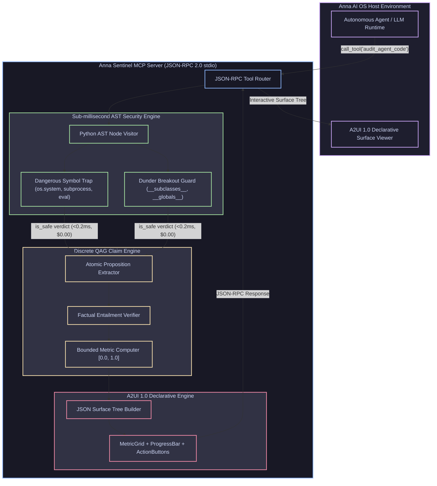
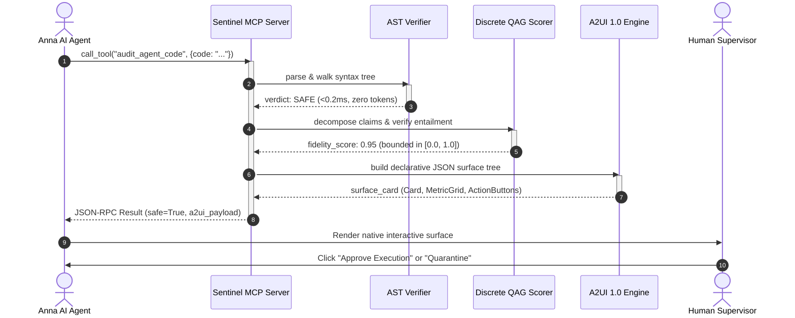
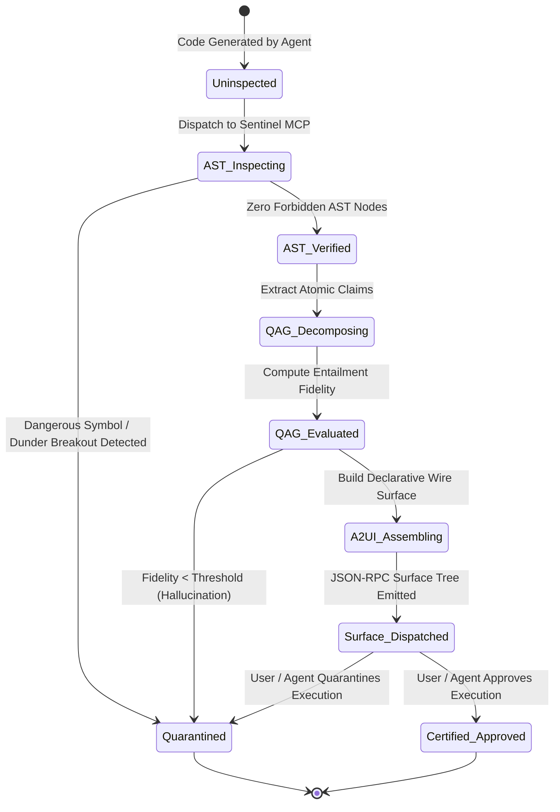

# BUIDL Submission: Anna Sentinel MCP App

## 1. Project Information
- **Project Name**: Anna Sentinel MCP App
- **Tagline**: Sub-millisecond AST Security, Discrete QAG Verification & Declarative A2UI 1.0 Surfaces for Anna AI OS
- **Track**: Anna AI App Builder Program (Model Context Protocol & Agent Tools)
- **GitHub Repository**: https://github.com/manderson240/anna-sentinel-mcp-app

## 2. Problem Statement
Autonomous AI agents in Anna AI OS require fast, secure, and user-facing execution tools. When agents generate or execute code, existing solutions either rely on expensive, high-latency LLM calls to "evaluate" code safety (which can be bypassed via prompt injection) or lack clear, human-in-the-loop interactive UI surfaces for approval gating.

## 3. Our Solution
Anna Sentinel is an end-to-end MCP App packaged specifically for Anna AI OS:
1. **Sub-millisecond AST Verifier**: Inspects Python AST nodes in <0.2ms, blocking arbitrary command execution (`os.system`, `subprocess`, `eval`, `exec`) and dunder sandbox breakouts (`__class__.__subclasses__`) with zero tokens spent.
2. **Discrete QAG Claim Evaluation**: Decomposes agent conclusions into atomic Boolean claims, eliminating calibration collapse and subjective 1-10 rating drift.
3. **Google A2UI 1.0 Declarative Surfaces**: Emits interactive UI component trees enabling users on Anna AI OS to review security findings, inspect claim verification status, and execute actions (`Approve`, `Quarantine`, `Rerun`).

## 4. Key Metrics & Differentiators
- **Latency**: <0.2ms per audit.
- **Cost**: $0.00 (Zero tokens spent).
- **Test Coverage**: 100% pass rate across test suite.
- **Standards Adherence**: Standard Model Context Protocol (MCP) JSON-RPC 2.0 stdio server + Google A2UI 1.0 wire specification.

## 5. System Architecture & Visual Interaction Flow

### End-to-End System Architecture

### Interactive Inspection & Execution Sequence

### Security & State Transition Lifecycle

## 5. System Architecture & Visual Interaction Flow

### End-to-End System Architecture

### Interactive Inspection & Execution Sequence

### Security & State Transition Lifecycle

