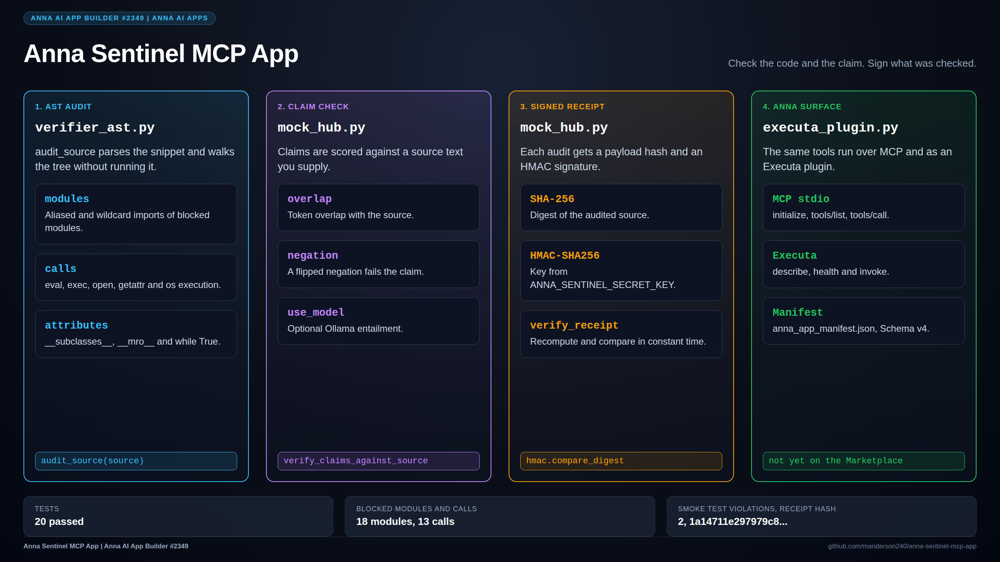

# Anna Sentinel MCP App

Anna Sentinel checks code and claims before an agent acts on them. It parses Python with the standard library `ast` module and rejects dangerous imports and calls, compares claim strings against a source text, and signs an HMAC receipt for each audited snippet. It runs as an MCP stdio server and as an Anna Executa plugin with a Schema v4 App Manifest. I built it for the [Anna AI App Builder Program](https://dorahacks.io/hackathon/anna-ai-app-builder).



[Demo video](https://raw.githubusercontent.com/manderson240/anna-sentinel-mcp-app/main/docs/anna_sentinel_demo.mp4)

## Program dates

The DoraHacks BUIDL window closes on November 30, 2026 at 15:59 UTC. The organizer's grants depend on two things: the app is published on the Anna Marketplace as an installable `#mention` app, and it reaches 200 or more Qualified App monthly active users. Qualification is open until March 31, 2027. This repo is the code. The Marketplace listing needs an Anna Developer Account, which I have not created yet, so nothing here is published or has users.

## Quickstart

Prerequisite: [uv](https://docs.astral.sh/uv/).

```bash
git clone https://github.com/manderson240/anna-sentinel-mcp-app.git
cd anna-sentinel-mcp-app
uv sync
uv run pytest -q
# MCP stdio server: initialize, tools/list, tools/call
uv run anna-sentinel-mcp
# Executa stdio plugin: describe, health, invoke
uv run anna-sentinel-executa
```

Smoke test of the Executa plugin:

```bash
echo '{"jsonrpc":"2.0","id":1,"method":"describe"}' | uv run anna-sentinel-executa
echo '{"jsonrpc":"2.0","id":2,"method":"invoke","params":{"tool":"audit_code","arguments":{"source_code":"import os as o\no.system(\"id\")"}}}' | uv run anna-sentinel-executa
```

Real output of the second command, trimmed to the audit (`elapsed_us` varies per run):

```json
{
  "is_safe": false,
  "violations": [
    "Line 1: Forbidden module import 'os'",
    "Line 2: Forbidden OS execution 'os.system()'"
  ],
  "metrics": {"elapsed_us": "<varies>", "nodes_visited": 10}
}
```

The same response carries an attestation object with `payload_hash`, `signature`, `timestamp` and `verified`. The `describe` call lists `audit_code`, `verify_claims`, `verify_receipt` and `create_a2ui_card`, the same four tools and arguments as the MCP server.

## How it works

1. **AST audit.** `src/anna_sentinel/verifier_ast.py` walks the parse tree. It blocks a list of modules (`os`, `subprocess`, `socket`, `ctypes`, `pickle` and others), including aliased and wildcard imports. It blocks calls such as `eval`, `exec`, `open` and `getattr`, a set of `os` execution functions, dunder attributes such as `__subclasses__` and `__mro__`, and `while True:` loops. The result lists violations and reports `elapsed_us` and `nodes_visited`.
2. **Claim check.** `verify_claims_against_source` in `src/anna_sentinel/mock_hub.py` scores each claim by token overlap with the source text and flags a mismatch in negation. With `use_model=true` it asks a model served by Ollama instead. That path needs a running Ollama server and is not covered by the offline tests.
3. **Receipt.** `audit_code` returns a SHA-256 payload hash and an HMAC-SHA256 signature. `verify_receipt` recomputes both and compares with `hmac.compare_digest`. The key comes from `ANNA_SENTINEL_SECRET_KEY`.
4. **Anna surface.** `executa_plugin.py` speaks the Executa JSON-RPC calls `describe`, `health` and `invoke`. `anna_app_manifest.json` is the Schema v4 manifest. `a2ui_renderer.py` builds a JSON review card.

## Configuration

| Variable | Used for | Default |
|---|---|---|
| `ANNA_SENTINEL_SECRET_KEY` | HMAC signing key | a fixed development key |
| `OLLAMA_BASE_URL` | model entailment when `use_model=true` | `http://127.0.0.1:11434` |

## Tests

```bash
uv run pytest -q
```

This prints `36 passed`. `tests/test_verifier_ast.py` covers a safe snippet, a syntax error, 21 bypass attempts and the antonym limit. `tests/test_sentinel_server.py` covers the MCP lifecycle, claims against a source text, a valid and a tampered receipt, the Executa calls, a check that MCP and Executa list the same tools and arguments, the manifest keys and the A2UI card.

## Limits

- The AST audit is a static check. It is not a sandbox and it does not run the code.
- Without `ANNA_SENTINEL_SECRET_KEY` the receipt is signed with a fixed development key, so set the variable before you rely on a receipt.
- The offline claim check is word overlap plus a negation flag. It does not understand meaning. For example "Revenue grew ten percent" is marked supported by the source "revenue fell ten percent". A test pins this limit.
- The module blocklist is a list, not a proof. A module I did not list can still pass.
- A bare reference to a dangerous builtin such as `f = eval` is flagged, so a variable named `input` or `vars` is also flagged.
- `use_model=true` needs Ollama and I have not put a measured result for it in this repo.
- The app is not published on the Anna Marketplace and has no users.

## Future roadmap

Create the Anna Developer Account, publish the app, and then measure Qualified App MAU against the 200 threshold.

## Hackathon deliverables

- [Architecture diagram](https://raw.githubusercontent.com/manderson240/anna-sentinel-mcp-app/main/docs/architecture_diagram.png)
- [Demo video](https://raw.githubusercontent.com/manderson240/anna-sentinel-mcp-app/main/docs/anna_sentinel_demo.mp4), 118 s, 2560x1440. Raw URL: https://raw.githubusercontent.com/manderson240/anna-sentinel-mcp-app/main/docs/anna_sentinel_demo.mp4
- [BUIDL text](BUIDL_SUBMISSION.md)

## License

MIT
