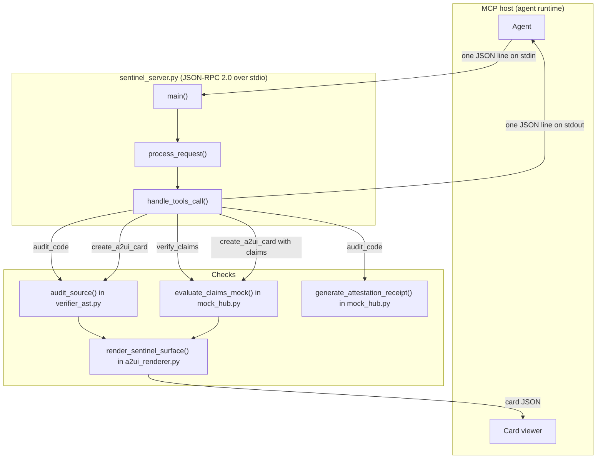
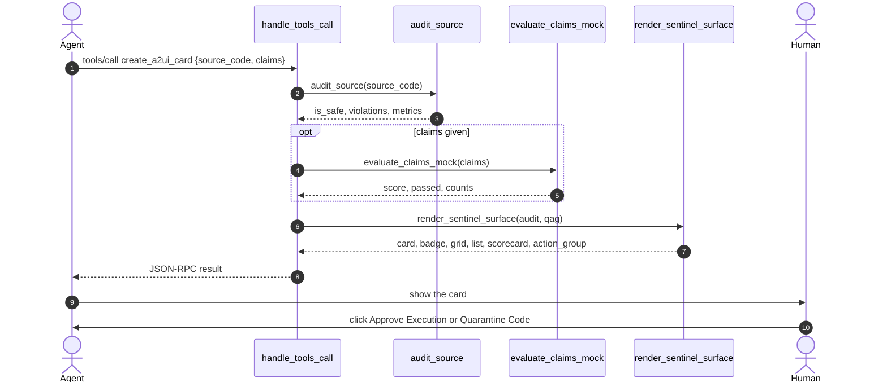
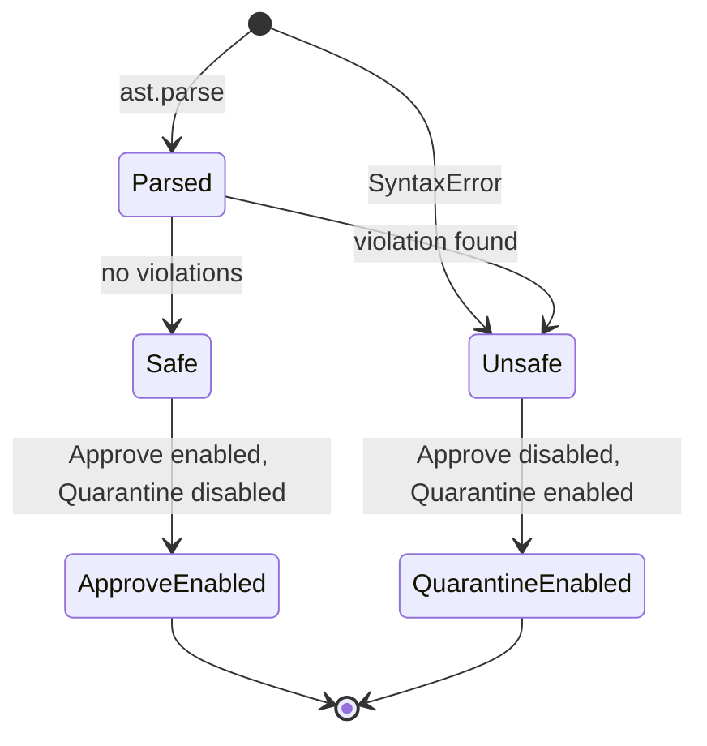

# Anna Sentinel MCP App

A small Model Context Protocol (MCP) server I built for the DoraHacks Anna AI App Builder Program. It speaks JSON-RPC 2.0 over stdio and gives an agent three tools: a static AST check for Python code, a claim score, and a JSON review card with Approve and Quarantine buttons for a human to click.

The AST check never runs the code it inspects and makes no model calls. On my machine it takes about 100 to 150 µs on the first call in a fresh process and has a median of 26 µs over 1,000 repeated calls on a five-line function.

The package has no runtime dependencies outside the Python standard library.

---

## Quickstart

```bash
git clone https://github.com/manderson240/anna-sentinel-mcp-app.git
cd anna-sentinel-mcp-app

# Run the tests
uv run pytest -q

# Start the MCP server on stdio (reads one JSON-RPC request per line)
uv run python -m anna_sentinel.sentinel_server
```

### Demo output

I piped these requests into the server: `initialize`, `tools/list`, `audit_code` on a clean Fibonacci function, `audit_code` on a payload with `from os import system` and a `__subclasses__` chain, and `verify_claims` with two supported claims and one unsupported claim.

```bash
printf '%s\n' \
'{"jsonrpc":"2.0","id":1,"method":"initialize","params":{}}' \
'{"jsonrpc":"2.0","id":2,"method":"tools/list","params":{}}' \
'{"jsonrpc":"2.0","id":3,"method":"tools/call","params":{"name":"audit_code","arguments":{"source_code":"def fib(n):\n    a, b = 0, 1\n    for _ in range(n):\n        a, b = b, a + b\n    return a\n"}}}' \
'{"jsonrpc":"2.0","id":4,"method":"tools/call","params":{"name":"audit_code","arguments":{"source_code":"from os import system\nx = ().__class__.__bases__[0].__subclasses__()\n"}}}' \
'{"jsonrpc":"2.0","id":5,"method":"tools/call","params":{"name":"verify_claims","arguments":{"claims":[{"text":"a","supported":true},{"text":"b","supported":true},{"text":"c","supported":false}]}}}' \
| uv run python -m anna_sentinel.sentinel_server
```

Output (trimmed: I removed the log timestamp, the `tools/list` response and the attestation blocks, and unpacked the JSON text inside each `content` item so it is readable):

```text
INFO [sentinel] Starting anna-sentinel-mcp-app JSON-RPC server on stdio...
{"jsonrpc": "2.0", "id": 1, "result": {"protocolVersion": "2024-11-05", "capabilities": {"tools": {}}, "serverInfo": {"name": "anna-sentinel-mcp-app", "version": "1.0.0"}}}

id 3 (clean code):
  "is_safe": true,
  "violations": [],
  "metrics": {"elapsed_us": 148.55, "nodes_visited": 43}

id 4 (malicious code):
  "is_safe": false,
  "violations": [
    "Line 1: Forbidden import 'from os import system'",
    "Line 2: Forbidden sandbox breakout attribute '__subclasses__'",
    "Line 2: Forbidden sandbox breakout attribute '__bases__'",
    "Line 2: Forbidden sandbox breakout attribute '__class__'"
  ],
  "metrics": {"elapsed_us": 72.78, "nodes_visited": 18}

id 5 (claims):
  "score": 0.6667, "passed": false, "total_claims": 3, "supported_claims": 2
```

`elapsed_us` is measured by the server with `time.perf_counter` and changes from run to run.

---

## How it works

There are four modules in [`src/anna_sentinel/`](src/anna_sentinel/):

1. [`sentinel_server.py`](src/anna_sentinel/sentinel_server.py): `main()` reads stdin line by line and passes each line to `process_request()`, which handles `initialize`, `tools/list`, `tools/call` and `notifications/initialized`. Bad JSON returns error `-32700` and unknown methods or tools return `-32601`. `handle_tools_call()` dispatches the three tools:
   - `audit_code(source_code)`: runs `audit_source()` and returns the audit plus an HMAC receipt from `generate_attestation_receipt()`.
   - `verify_claims(claims)`: runs `evaluate_claims_mock()`.
   - `create_a2ui_card(source_code, claims?)`: runs the audit (and the claim score if claims are given) and returns the card from `render_sentinel_surface()`.
2. [`verifier_ast.py`](src/anna_sentinel/verifier_ast.py): `ASTVerifier` is an `ast.NodeVisitor`. It parses the source with `ast.parse` and flags:
   - calls to `eval`, `exec`, `__import__`, `getattr`, `setattr`, `delattr` by name (`DANGEROUS_CALLS`)
   - any import of `subprocess` or `importlib` (`DANGEROUS_MODULES`)
   - `from os import system` / `popen` and calls written as `os.system(...)` / `os.popen(...)`
   - any attribute access to `__class__`, `__subclasses__`, `__bases__`, `__globals__`, `__builtins__`, `__dict__`, `__code__` (`SANDBOX_BREAKOUT_ATTRS`)
   - syntax errors, which are reported as a violation

   It returns an `ASTAuditResult` with `is_safe`, the list of violations with line numbers, the elapsed time and the number of nodes visited.
3. [`mock_hub.py`](src/anna_sentinel/mock_hub.py): `evaluate_claims_mock()` takes claims that already carry a `supported` boolean and returns `supported / total`, rounded to 4 places, with `passed = score >= 0.85`. `generate_attestation_receipt()` signs `payload:timestamp` with HMAC-SHA256 and also returns the SHA-256 of the payload.
4. [`a2ui_renderer.py`](src/anna_sentinel/a2ui_renderer.py): `render_sentinel_surface()` builds a JSON tree with `version: "1.0"`: a `card` header, a `badge` (green "PASSED: AST Secure" or red "ALERT: N Violations"), a `grid` with latency and node count, a `list` of violations if there are any, a `scorecard` if claims were scored, and an `action_group` with three buttons. "Approve Execution" is disabled when the code is unsafe and "Quarantine Code" is disabled when it is safe.

### Architecture



### create_a2ui_card sequence



### Button states



---

## Configuration

The code does not read any environment variables. The HMAC key defaults to `anna-sentinel-mock-key` in `generate_attestation_receipt()`, and the server does not pass a different one.

---

## Tests

```bash
uv run pytest -q
```

10 tests, all passing in 0.01 s on my machine, with no network calls:

- [`tests/test_verifier_ast.py`](tests/test_verifier_ast.py) (6): clean code passes, `os.system`, `subprocess`, `eval` and a `__class__` / `__subclasses__` chain are flagged, and a syntax error is reported.
- [`tests/test_sentinel_server.py`](tests/test_sentinel_server.py) (4): `initialize`, `tools/list` returns the three tools, `audit_code` flags `subprocess` and returns a signature, and the renderer returns a version 1.0 tree with a badge.

---

## Limits

- This is a short denylist, not a sandbox. I checked these cases by hand and all of them pass as safe today: `import os` on its own, `import os as o; o.system("ls")`, `os.execv(...)`, `open("/etc/passwd")`, `import socket`, `import builtins; builtins.eval("1")`, and `while True: pass`. Code that passes the check still needs to run in a real sandbox.
- The server never runs the code, so there is no timeout or resource limit to test.
- `verify_claims` does not extract or check claims. The caller has to send each claim with `supported` already set, and the tool only counts them.
- The receipt uses a hard-coded demo key and always returns `"verified": true`. There is no function that checks a receipt. Treat it as a placeholder.
- The card is my own JSON layout with `version: "1.0"` and component types `card`, `badge`, `grid`, `list`, `scorecard`, `action_group`. I have not validated it against the published A2UI schema.
- The button `call` values (`anna.sentinel.approve`, `anna.sentinel.quarantine`, `anna.sentinel.rerun`) are strings only. The server has no handler for them; the host has to act on the click.
- I tested the server by piping JSON-RPC lines into it and through the unit tests. Only Python source is supported.

---

## Hackathon deliverables

- Submission text: [`BUIDL_SUBMISSION.md`](BUIDL_SUBMISSION.md)
- Demo video: [`docs/anna_sentinel_demo.mp4`](docs/anna_sentinel_demo.mp4), generated with `python3 scripts/generate_pitch_video.py`

## License

MIT
